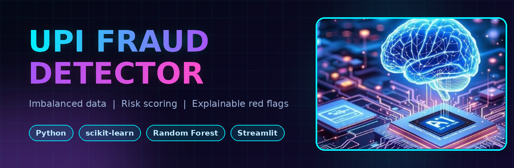
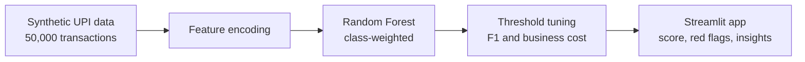
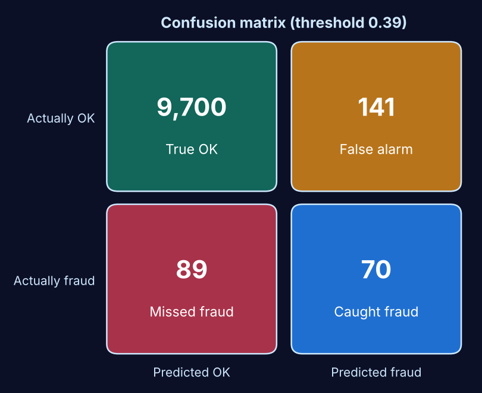
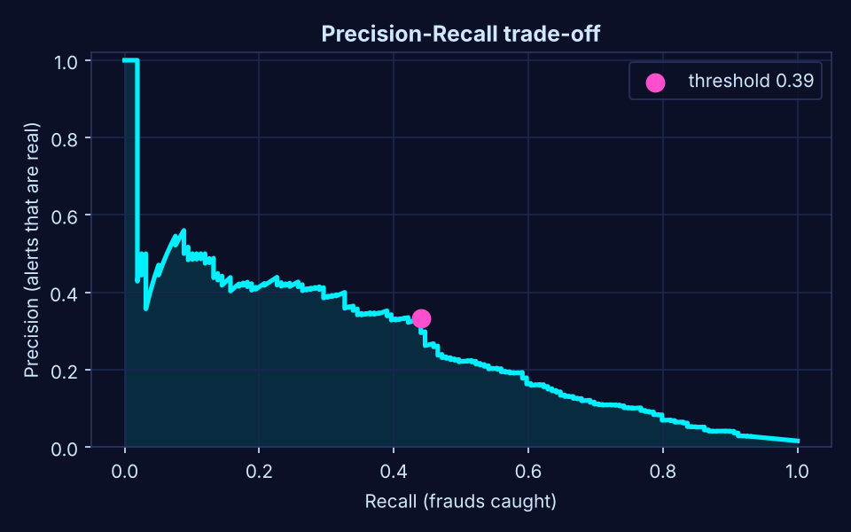
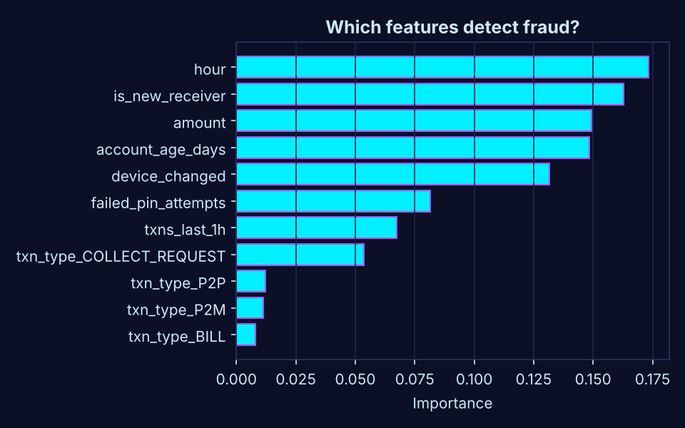

<p align="center">
  
</p>

<p align="center">
  
  
  
  
  
</p>

# 🛡️ UPI Fraud Detector

An end-to-end machine learning project that scores UPI transactions for fraud risk, explains the red flags behind each score, and shows the **business cost** of different decision thresholds.

🔗 **Live Demo:** *(add your Streamlit link here after deploying)*

> ⚠️ **Data note:** Real UPI transaction data is private, so this project uses **synthetic data**. Fraud labels follow hand-written risk rules (late night, new device, collect requests...) plus random noise. The results prove the pipeline works, not real-world fraud performance.

## ✨ Features

| | |
|---|---|
| 🔍 **Check Transaction** | Enter one payment, get a risk gauge, a verdict and the red flags behind it |
| 📂 **Batch Scan** | Upload a CSV, score every row, download the results |
| 📊 **Model Insights** | Move the threshold slider and watch precision, recall, confusion matrix and PR curve change live |
| 💰 **Business cost view** | Set the loss per missed fraud and the cost per false alarm, find the cheapest threshold |

## 🎯 Problem

Fraud is a tiny fraction of UPI transactions (about 1.6% here). A fraud system must catch scams without blocking genuine payments. The hard parts are **imbalanced data**, choosing the right **metrics**, and picking a **decision threshold** that matches business cost.

## 🧠 How it works



1. Generate 50,000 synthetic transactions: amount, hour, type, new receiver, device change, velocity, account age, failed PINs
2. Stratified 80/20 train-test split so both sets keep the same fraud rate
3. Random Forest with `class_weight="balanced_subsample"` to handle imbalance
4. Tune the decision threshold instead of using the default 0.5
5. Explain each prediction with human-readable red flags

## 📈 Results (synthetic test set, 10,000 transactions)

| Metric | Value |
|---|---|
| Accuracy of "always say not fraud" | **98.4%** (useless model) |
| Model accuracy | 97.7% |
| Precision (fraud) | 0.33 |
| Recall (fraud) | 0.44 |
| F1 (fraud) | 0.38 |
| PR-AUC | 0.26 |

**Key lesson:** accuracy is misleading on imbalanced data. A model that never flags fraud already scores 98.4%. Precision, recall, F1 and PR-AUC tell the real story.

<p align="center">
  
  
</p>

<p align="center">
  
</p>

## 💰 Business impact

Assumptions: a missed fraud costs Rs 5,000, a false alarm costs Rs 100 (customer friction).

| Strategy | Frauds caught | Missed | False alarms | Total cost |
|---|---|---|---|---|
| No model (flag nothing) | 0 | 159 | 0 | Rs 7,95,000 |
| Model, F1-optimal threshold (0.39) | 70 | 89 | 141 | Rs 4,59,100 |
| Model, cost-optimal threshold (0.08) | 123 | 36 | 1,177 | **Rs 2,97,700** |

The best threshold depends on cost, not on F1 alone. When missing fraud is expensive, flag more aggressively and accept more false alarms.

## 🚀 Run locally

```bash
git clone https://github.com/varshini-S-max/upi-fraud-detector.git
cd upi-fraud-detector
python -m venv venv
venv\Scripts\activate        # Windows  (Mac/Linux: source venv/bin/activate)
pip install -r requirements.txt
streamlit run app.py
```

- Print metrics and regenerate charts: `python train.py`
- Run tests: `pytest`
- Try it in Google Colab: open `upi_fraud_detection.ipynb`
- Try Batch Scan with the included `sample_transactions.csv`

## 📁 Project structure

```
upi-fraud-detector/
├── app.py                      # Streamlit app (3 tabs)
├── fraud_detector.py           # Data generation, training, scoring, cost analysis
├── charts.py                   # Neon-dark charts used by the app and train.py
├── train.py                    # Train, print metrics, save charts
├── test_fraud.py               # Unit tests
├── upi_fraud_detection.ipynb   # Step-by-step Colab notebook
├── sample_transactions.csv     # Try the Batch Scan tab
├── metrics.json                # Saved evaluation metrics
├── hero.png, banner.jpg        # Images
├── *.png                       # Generated charts
└── requirements.txt
```

## ⚠️ Limitations

- Synthetic data: the labels come from rules I wrote, so the model partly learns my rules
- Single model (Random Forest), no deep learning or graph features
- No real-time pipeline and no concept-drift handling
- Cost numbers are assumptions, not real bank data

## 🔮 Future improvements

- Validate on a real public dataset (for example PaySim on Kaggle)
- Compare XGBoost and LightGBM
- Add SHAP explanations for every prediction
- Add a REST API (FastAPI) so other apps can call the model

## 👩‍💻 Author

varshini-S-max · [GitHub](https://github.com/varshini-S-max)
